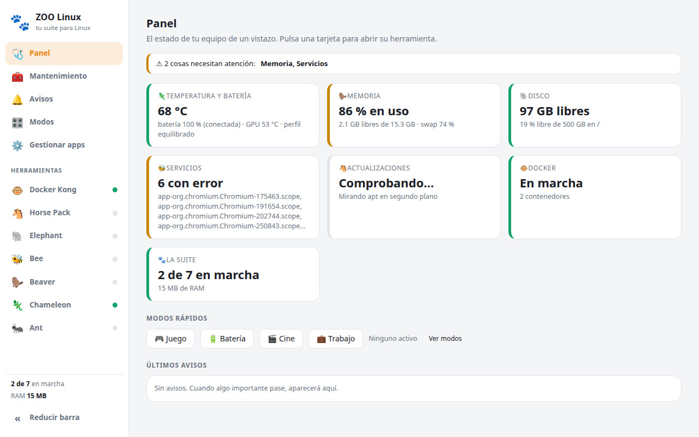
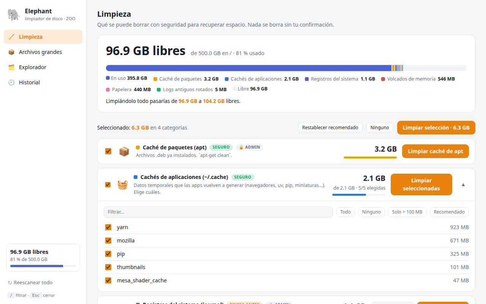
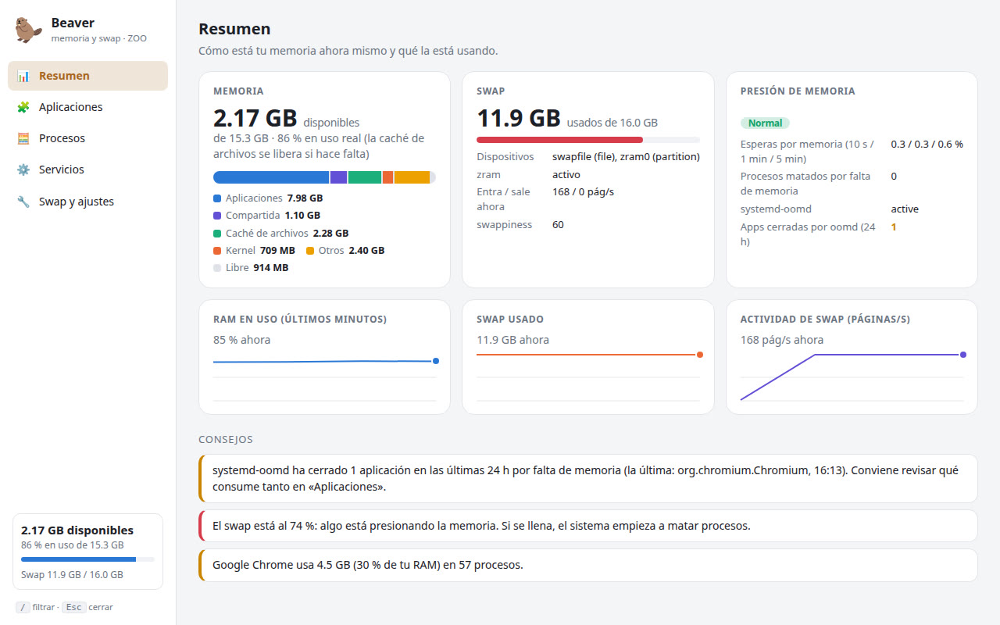
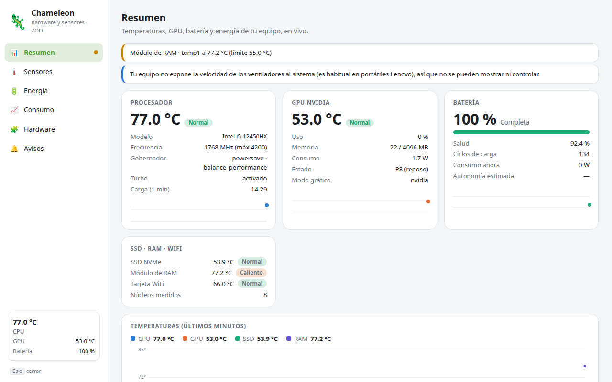
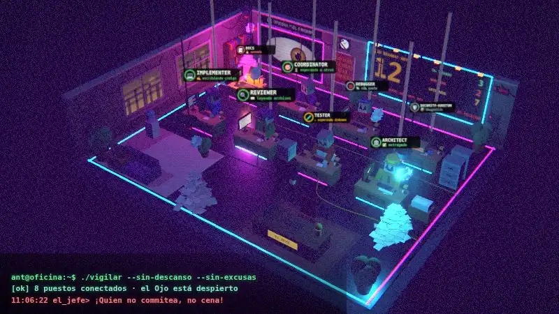
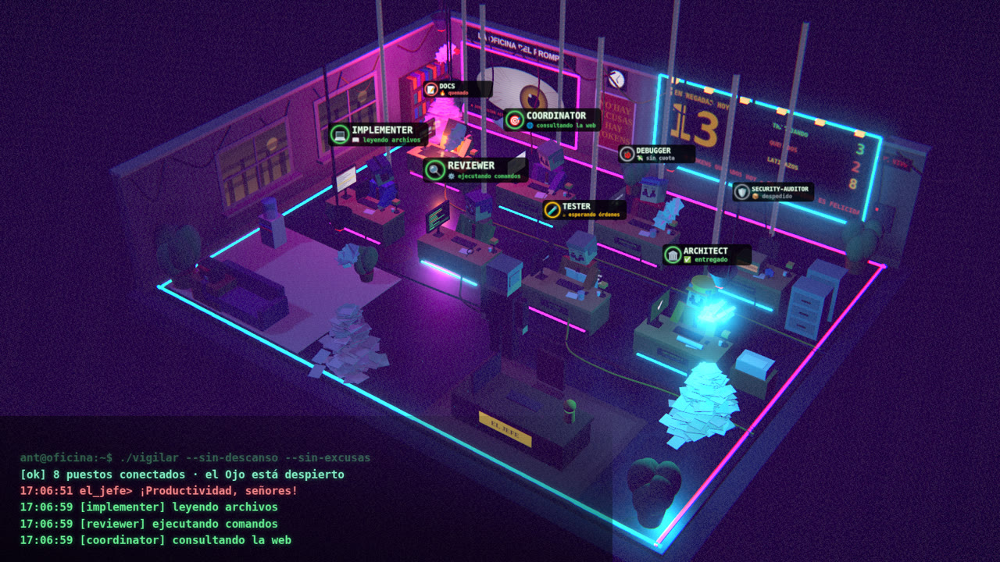

<div align="center">

# 🐾 ZOO Linux

**Paneles web locales, pequeños, para gestionar tu escritorio Linux — un animal por tarea.**

Limpieza de disco · systemd · memoria y swap · sensores y batería · paquetes · Docker · todo en `127.0.0.1`,
solo biblioteca estándar de Python, sin compilar, sin nube y sin telemetría.

[](https://github.com/Jhostter/zoo-linux/actions/workflows/ci.yml)
[](LICENSE)


🇬🇧 [English README](README.md) · [Portabilidad](docs/PORTABILITY.md) · [Contribuir](CONTRIBUTING.md)

 
 

<sub>Capturas: ZOO, Elephant, Beaver y Chameleon (Elephant muestra carpetas de caché de ejemplo).</sub>

</div>

## Por qué

Linux tiene herramientas excelentes, pero dispersas: una terminal para `systemctl`, otra para `apt`, una GUI para el disco, `htop` para
la memoria, `sensors` para las temperaturas… ZOO pone cada tarea en una **app web pequeña y enfocada**, con el mismo aspecto, valores
seguros por defecto y explicaciones en lenguaje claro, y un **lanzador** que muestra el estado de tu equipo de un vistazo. Cada panel solo
escucha en tu propio equipo y las apps cuestan casi nada en reposo.

## El zoo

| | App | Qué hace | Puerto |
|---|---|---|---|
| 🐾 | **[ZOO](zoo/)** | Lanzador y centro de control: resumen del sistema, estado/CPU/RAM de las apps, avisos, **modos** (juego / batería / trabajo / cine), revisión de mantenimiento; las apps arrancan **bajo demanda** y se paran en reposo | 4400 |
| 🐘 | **[Elephant](apps/elephant/)** | Limpiador de disco: cachés de paquetes y apps, papelera, logs, kernels, archivos grandes, explorador, historial | 4477 |
| 🐝 | **[Bee](apps/bee/)** | Gestor de systemd: servicios, temporizadores, sockets, montajes, arranque, autostart, cron, asistentes para crear servicios y temporizadores | 4488 |
| 🦫 | **[Beaver](apps/beaver/)** | Memoria y swap: consumo por aplicación, zram, swappiness, presión (PSI), systemd-oomd, límites por servicio | 4499 |
| 🦎 | **[Chameleon](apps/chameleon/)** | Sensores y hardware: temperaturas, salud de batería, perfiles de energía, GPU NVIDIA, inventario, historial y avisos | 4500 |
| 🐴 | **[Horse Pack](apps/horse-pack/)** | Paquetes: apt/dpkg, archivos `.deb`/tar/AppImage, Flatpak, Snap, diagnóstico de bloqueos de apt | 4466 |
| 🐜 | **[Ant](apps/ant/)** | Panel de enjambres de agentes de [Antigravity](https://antigravity.google) y oficina 3D para stream (estilos voxel / toon / cyberpunk) | 4511 |
| 🐵 | **[Docker Kong](https://github.com/Jhostter/docker-kong)** | Gestor de Docker (Node.js), en su propio repositorio | 4455 |

> ⚠️ **Alfa.** Construida y probada en un solo equipo (Pop!_OS 24.04 + COSMIC, Python 3.12). Está pensada para degradar con elegancia en otros
> sistemas (la CI arranca cada app con Python 3.9 y 3.12, también con `PATH` vacío), pero varias acciones con privilegios (`pkexec`) solo se
> probaron con binarios falsos. Estas herramientas pueden borrar archivos y parar servicios: **lee lo que hace una acción antes de confirmarla.**
> Detalles en [docs/PORTABILITY.md](docs/PORTABILITY.md).

## 🐜 La oficina animada de Ant

[Ant](apps/ant/) puede mostrar tus agentes de Antigravity como empleados en una oficina 3D pensada para OBS/stream: teclean, se cansan,
entran en pánico, celebran, se mandan aviones de papel y el jefe pasea con un látigo. Es WebGL en tiempo real (Three.js incluido),
con **tres estilos visuales que cambias desde Ant** (🎨 *Estilo de la oficina*): OBS recoge el cambio solo.

<div align="center">

<br><sub>Estilo cyberpunk (animación: el látigo del jefe, a cámara lenta).</sub>
<br><br>
  
<br><sub><b>Voxel</b> (tipo Minecraft) · <b>Toon</b> (contornos, colores planos) · <b>Cyberpunk</b> (neón, bloom, grano) — datos de ejemplo</sub>
</div>

## Inicio rápido

Necesitas Linux con **systemd** (sesión de usuario) y **Python ≥ 3.9**. Nada más que instalar.

```sh
git clone https://github.com/Jhostter/zoo-linux.git
cd zoo-linux

./install.sh --dry-run     # ver exactamente qué haría
./install.sh               # lanzador + las apps recomendadas para este equipo
```

Abre **http://localhost:4400**.

<details>
<summary>Más opciones de instalación</summary>

```sh
./install.sh --all                       # todo, incluida Ant
./install.sh --apps bee,elephant         # solo esas (el lanzador siempre se instala)
./install.sh --tray                      # además, icono de bandeja (python3-gi, python3-gi-cairo, gir1.2-ayatanaappindicator3-0.1)
./install.sh --list                      # apps y puertos
./uninstall.sh                           # quita los servicios (tus datos nunca se borran)
```

¿Solo probar? Ejecuta una app sin instalar: `python3 apps/bee/server.py` → http://localhost:4488.
Horse Pack se instala por defecto solo si hay `apt`; Ant solo si la pides.
</details>

**Qué hace el instalador:** por cada app escribe una unidad de *usuario* de systemd (`~/.config/systemd/user/<app>.service`) que ejecuta
`python3 <esta carpeta>/…/server.py` con límites de CPU/RAM, y la activa. Sin root y sin tocar nada fuera de tu carpeta personal.
Como las unidades apuntan a esta carpeta, no la muevas (si la mueves, vuelve a ejecutar `./install.sh`).

## Cómo funciona

```
 navegador ─► lanzador ZOO :4400 ──► systemctl --user start/stop/status ──► cada app (su servicio y su puerto)
                │  salud, avisos, modos, arranque bajo demanda, tema compartido
                └── marco con iframes ──► Elephant :4477 · Bee :4488 · Beaver :4499 · Chameleon :4500 · Horse Pack :4466 · Ant :4511 · Kong :4455
```

Cada app es un `server.py` (Python `http.server`) más un front-end estático (JS/CSS planos). El lanzador no necesita que las apps estén en
marcha: las despierta al abrirlas y las aparca tras un rato sin uso.

### Reglas comunes a todas las apps

- **Solo local:** escucha en `127.0.0.1`, valida `Host`/`Origin` (anti DNS-rebinding) y todo `POST` exige una cabecera propia (anti-CSRF).
- **Sin dependencias:** biblioteca estándar de Python; front-ends sin herramientas de build; tema claro/oscuro desde una sola hoja de estilos.
- **Seguro por defecto:** los borrados se limitan a ubicaciones seguras y piden confirmación (escrita para lo protegido).
- **Privilegios con cuidado:** las acciones de root usan `pkexec` con comandos fijos y argumentos validados. Si no hay agente polkit
  (algunos escritorios, servicios de usuario), la app muestra el comando `sudo …` exacto para copiar en vez de fallar.
- **Huella mínima:** cuotas de CPU/RAM por servicio, apps paradas en reposo, muestreo barato.
- **Nunca se cae por falta de un programa:** ¿sin `apt`, `nvidia-smi` o `flatpak`? Esa sección simplemente queda vacía.

## Compatibilidad de un vistazo

| | |
|---|---|
| ✅ Probado | Pop!_OS 24.04 (COSMIC) · Python 3.12 · x86-64 · portátil híbrido NVIDIA/Intel · Python 3.9 y 3.12 en CI (humo) |
| 🟡 Debería funcionar, sin probar | Ubuntu/Debian/Mint con GNOME o KDE · Fedora/Arch/openSUSE (salvo Horse Pack, basado en apt) |
| ❌ No soportado | Sistemas sin systemd · macOS · Windows |

Los perfiles de energía de Chameleon usan `system76-power`; las funciones de GPU necesitan `nvidia-smi`; Horse Pack necesita apt al estilo Debian/Ubuntu.
Tabla completa: [docs/PORTABILITY.md](docs/PORTABILITY.md).

## Preguntas frecuentes

**¿Es seguro ejecutarlo?** Todo es local y corre como tu usuario. Aun así, Elephant borra archivos, Bee gestiona servicios y Beaver/Chameleon
pueden cambiar ajustes del sistema con polkit. Cada acción destructiva pregunta antes, pero es software alfa: lee antes de confirmar.

**¿Por qué Python y JS plano?** Para que cualquiera pueda leerlo, cambiarlo y ejecutarlo sin instalar nada: sin build, sin `node_modules`, sin `pip install`.

**¿Puedo usar solo una app?** Sí, son independientes: `./install.sh --apps elephant` (más el lanzador) o `python3 apps/elephant/server.py` directamente.

**¿Y el idioma?** La interfaz está en español por ahora; las traducciones son la contribución más bienvenida después de probar en otras distros.

**¿Dónde quedan mis datos?** Ajustes en `~/.config/<app>/` y datos en `~/.local/share/<app>/` (historial, logs, cachés). `./uninstall.sh` los deja.

## Hoja de ruta

- [ ] i18n (inglés primero) · [ ] más distros (power-profiles-daemon en Chameleon, dnf/pacman en Horse Pack)
- [ ] Paquetes `.deb` / AUR / Flatpak · [ ] nuevos animales: 🦉 Owl (logs), 🐿️ Squirrel, 🐢 Turtle…

## Contribuir y seguridad

Probar en tu distro y escritorio es la ayuda más valiosa: abre un issue de *Compatibility report*. Mira [CONTRIBUTING.md](CONTRIBUTING.md)
(reglas y bucle de desarrollo: `python3 test/smoke.py`) y [SECURITY.md](SECURITY.md) para informar vulnerabilidades en privado.

## Licencia

[MIT](LICENSE) © 2026 Jhostter · avisos de terceros en [THIRD_PARTY_NOTICES.md](THIRD_PARTY_NOTICES.md).
