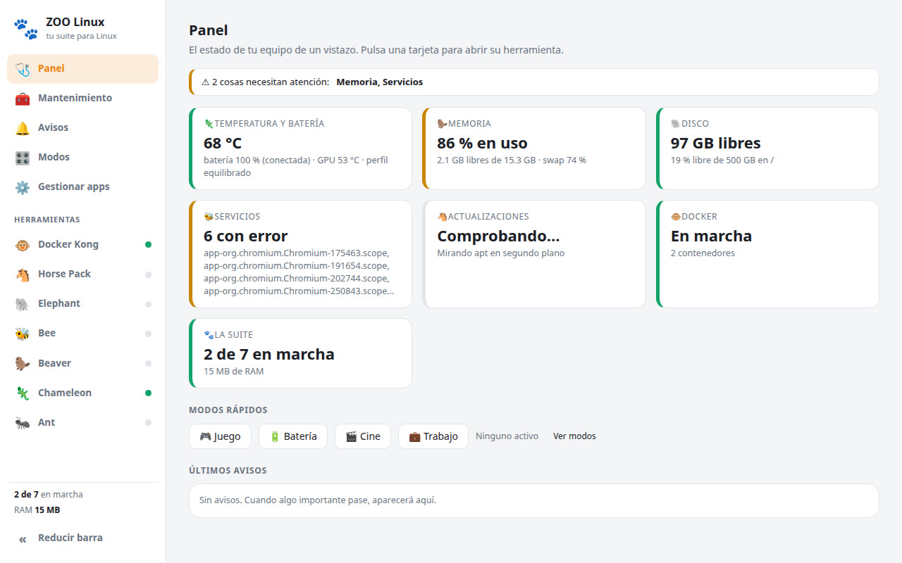
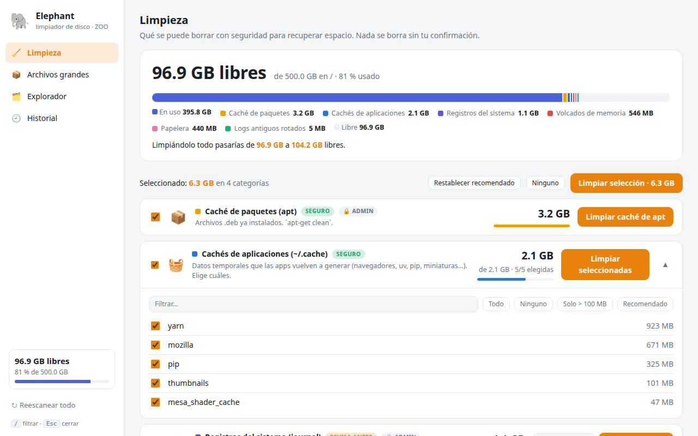
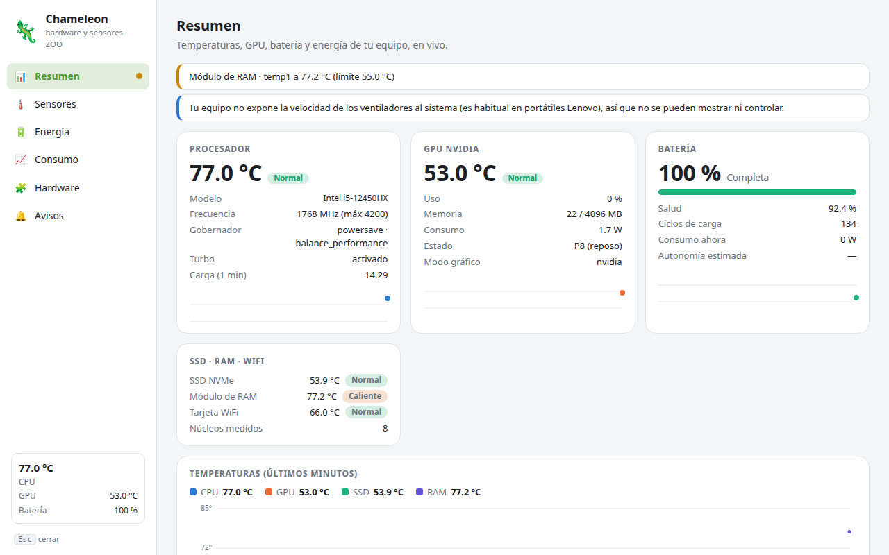

<div align="center">

# 🐾 ZOO Linux

**Small local web panels to manage your Linux desktop — one animal per job.**

Disk cleaning · systemd · memory & swap · sensors & battery · packages · Docker · all on `127.0.0.1`,
pure Python standard library, no build step, no cloud, no telemetry.

[](https://github.com/Jhostter/zoo-linux/actions/workflows/ci.yml)
[](LICENSE)


🇪🇸 [Léeme en español](README.es.md) · [Portability](docs/PORTABILITY.md) · [Contributing](CONTRIBUTING.md)

 
 

<sub>Screenshots: ZOO, Elephant, Beaver and Chameleon (the interface is currently in Spanish; Elephant shows demo cache folders).</sub>

</div>

## Why

Linux desktops have great tools, but they are scattered: a terminal for `systemctl`, another for `apt`, a GUI for
the disk, `htop` for memory, `sensors` for temperatures… ZOO puts each job in a **small, focused web app** with a
consistent look, safe defaults and plain-language explanations, and a **launcher** that shows the state of your
machine at a glance. Every panel only listens on your own computer, and the apps cost almost nothing when idle.

## The zoo

| | App | What it does | Port |
|---|---|---|---|
| 🐾 | **[ZOO](zoo/)** | Launcher & control center: system overview, app status/CPU/RAM, alerts feed, usage **modes** (gaming / battery / work / cinema), maintenance check, apps start **on demand** and stop when idle | 4400 |
| 🐘 | **[Elephant](apps/elephant/)** | Disk cleaner: package/app caches, trash, old logs, kernels, big files, folder explorer, cleaning history | 4477 |
| 🐝 | **[Bee](apps/bee/)** | systemd manager: services, timers, sockets, mounts, boot analysis, login autostart, crontab, wizards to create services/timers | 4488 |
| 🦫 | **[Beaver](apps/beaver/)** | Memory & swap: per-application usage, zram, swappiness, pressure (PSI), systemd-oomd, per-service limits | 4499 |
| 🦎 | **[Chameleon](apps/chameleon/)** | Sensors & hardware: temperatures, battery health, power profiles, NVIDIA GPU, inventory, history and alerts | 4500 |
| 🐴 | **[Horse Pack](apps/horse-pack/)** | Packages: apt/dpkg, `.deb`/tar/AppImage files, Flatpak, Snap, diagnose apt locks | 4466 |
| 🐜 | **[Ant](apps/ant/)** | Dashboard for [Antigravity](https://antigravity.google) agent swarms, plus a 3D "stream office" with voxel / toon / cyberpunk styles | 4511 |
| 🐵 | **[Docker Kong](https://github.com/Jhostter/docker-kong)** | Docker manager (Node.js) — lives in its own repository | 4455 |

> ⚠️ **Alpha.** Built and tested on one machine (Pop!_OS 24.04 + COSMIC, Python 3.12). It is designed to degrade
> gracefully elsewhere — CI boots every app on Python 3.9 and 3.12, also with an empty `PATH` — but several
> privileged actions (`pkexec`) have only been tested against fake binaries. These tools can delete files and stop
> services: **read what an action does before confirming it.** Details in [docs/PORTABILITY.md](docs/PORTABILITY.md).

## Quick start

You need Linux with **systemd** (user session) and **Python ≥ 3.9**. Nothing else to install.

```sh
git clone https://github.com/Jhostter/zoo-linux.git
cd zoo-linux

./install.sh --dry-run     # see exactly what it would do
./install.sh               # launcher + the apps recommended for this machine
```

Open **http://localhost:4400**.

<details>
<summary>More install options</summary>

```sh
./install.sh --all                       # everything, including Ant
./install.sh --apps bee,elephant         # only these (the launcher is always installed)
./install.sh --tray                      # also a tray icon (needs python3-gi, python3-gi-cairo, gir1.2-ayatanaappindicator3-0.1)
./install.sh --list                      # apps and ports
./uninstall.sh                           # remove the services (your data is never deleted)
```

Just trying it? Run any app without installing: `python3 apps/bee/server.py` → http://localhost:4488.
Horse Pack is installed by default only if `apt` is present; Ant only if you ask for it.
</details>

**What the installer does:** for each app it writes a systemd *user* unit (`~/.config/systemd/user/<app>.service`) that
runs `python3 <this folder>/…/server.py` with CPU/RAM limits, then enables it. No root, nothing outside your home
directory. Because units point at this folder, keep it where it is (re-run `./install.sh` if you move it).

## How it works

```
 browser ─► ZOO launcher :4400 ──► systemctl --user start/stop/status ──► each app (its own service + port)
              │  health, alerts, modes, on-demand wake-up, shared theme
              └── iframe shell ──► Elephant :4477 · Bee :4488 · Beaver :4499 · Chameleon :4500 · Horse Pack :4466 · Ant :4511 · Kong :4455
```

Each app is one `server.py` (Python `http.server`) plus a static front-end (plain JS/CSS). The launcher doesn't need the
apps to be running: it wakes them when you open them and parks them after a while without use.

### Design rules shared by every app

- **Local only:** binds to `127.0.0.1`, validates `Host`/`Origin` (anti DNS-rebinding), and every `POST` needs a custom header (anti-CSRF).
- **No dependencies:** Python standard library; front-ends without build tools; light & dark theme from one shared stylesheet.
- **Safe by default:** deletions are limited to safe locations and ask for confirmation (typed confirmation for protected items).
- **Privileges done carefully:** root actions go through `pkexec` with fixed commands and validated arguments. When no polkit
  agent is reachable (some desktops, user services), the app shows the exact `sudo …` command to copy instead of failing.
- **Tiny footprint:** CPU/RAM quotas per service, idle apps are stopped, sampling is cheap.
- **Never crashes on a missing tool:** no `apt`, `nvidia-smi` or `flatpak`? That section is just empty.

## Compatibility at a glance

| | |
|---|---|
| ✅ Tested | Pop!_OS 24.04 (COSMIC) · Python 3.12 · x86-64 · NVIDIA/Intel hybrid laptop · Python 3.9 & 3.12 in CI (smoke) |
| 🟡 Expected to work, untested | Ubuntu/Debian/Mint on GNOME or KDE · Fedora/Arch/openSUSE (except Horse Pack, which is apt-based) |
| ❌ Not supported | Systems without systemd · macOS · Windows |

Chameleon's power profiles use `system76-power`; GPU features need NVIDIA's `nvidia-smi`; Horse Pack needs Debian/Ubuntu-style apt.
Full table: [docs/PORTABILITY.md](docs/PORTABILITY.md).

## FAQ

**Is it safe to run?** Everything is local and runs as you. Still, Elephant deletes files, Bee manages services and Beaver/Chameleon
can change system settings through polkit. Each destructive action asks first, but this is alpha software: read before confirming.

**Why Python and plain JS?** So that anyone can read, change and run it with nothing to install. There is no build, no `node_modules`, no `pip install`.

**Can I use only one app?** Yes — they are independent. `./install.sh --apps elephant` (plus the launcher), or run `python3 apps/elephant/server.py` directly.

**The interface is in Spanish.** Yes, for now; translations are the most welcome contribution after testing on other distros.

**Where is my data?** Settings in `~/.config/<app>/` and `~/.local/share/<app>/` (history, logs, caches). `./uninstall.sh` leaves them in place.

## Roadmap

- [ ] i18n (English first) · [ ] more distro support (power-profiles-daemon in Chameleon, dnf/pacman in Horse Pack)
- [ ] `.deb` / AUR / Flatpak packaging · [ ] new animals: 🦉 Owl (logs), 🐿️ Squirrel, 🐢 Turtle…

## Contributing & security

Testing on your distro and desktop is the most valuable help — open a *Compatibility report* issue. See
[CONTRIBUTING.md](CONTRIBUTING.md) for the ground rules and dev loop (`python3 test/smoke.py`) and [SECURITY.md](SECURITY.md)
to report vulnerabilities privately.

## License

[MIT](LICENSE) © 2026 Jhostter · third-party notices in [THIRD_PARTY_NOTICES.md](THIRD_PARTY_NOTICES.md).
